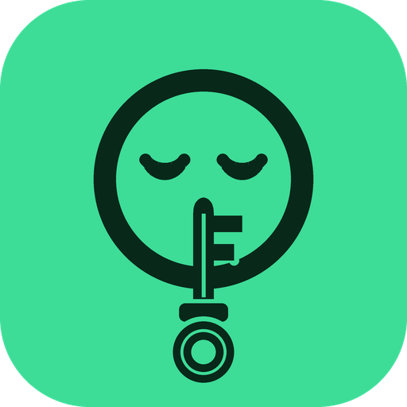

<p align="center"></p>

<h1 align="center">HushKey</h1>

<p align="center">A simple, secure password manager for <b>Windows and Mac</b>.<br>Your logins stay encrypted on your computer, and you can recover your vault by email.</p>

<p align="center">
  <a href="../../releases/latest/download/HushKey-Windows.exe"></a>
  &nbsp;&nbsp;
  <a href="../../releases/latest/download/HushKey-Mac.zip"></a>
</p>

<p align="center"><b>Latest version: v2.0.9</b> · The buttons always download the newest release · <a href="../../releases">All releases</a></p>

### 🪟 Installing HushKey on Windows (first time only)

HushKey is free and open source, but it isn't signed with a paid code-signing certificate yet, so Microsoft shows a few extra warnings the first time. They don't mean the app has a virus. Every download is built in public from this code by GitHub (see [Is it safe?](#is-it-safe)).

1. **Download:** click **Download for Windows** above.
2. **Microsoft Edge** may say *"HushKey-Windows.exe isn't commonly downloaded."* Click the **⋯** next to the download → **Keep** → **Show more** → **Keep anyway**. (Chrome: click **Keep**.)
3. **Run the installer.** If a blue box says *"Windows protected your PC"* (Microsoft Defender SmartScreen), click **More info** → **Run anyway**.
4. Follow the installer (no admin password needed). HushKey opens when it's done and is added to your Start menu.

**Smart App Control:** on some Windows 11 PCs, *Smart App Control* blocks apps that aren't signed and offers no "Run anyway" button. You can check it in **Windows Security → App & browser control → Smart App Control**. Turning it off lets HushKey run, but it also lowers protection for every other app, so only do it if you're comfortable with that. Recent Windows 11 updates let you turn it back on afterward without reinstalling Windows.

**Updating:** from v2.0.9 on, HushKey updates itself (see [Automatic updates](#automatic-updates)). The warnings above only appear on the first install.

### 🍎 Opening HushKey on a Mac (first time only)

macOS shows a warning because HushKey isn't signed with a paid Apple Developer account. It isn't saying the app has a virus. You only need to approve it once:

**The normal way (macOS Sequoia and newer)**

1. Move **HushKey** into your **Applications** folder (unzip `HushKey-Mac.zip` first).
2. Double-click HushKey. When the warning appears, click **Done**. Don't click "Move to Trash".
3. Open **System Settings → Privacy & Security**.
4. Scroll down to the **Security** section. You'll see *"HushKey" was blocked to protect your Mac*. Click **Open Anyway**.
5. Enter your Mac password (or use Touch ID), then click **Open Anyway** once more.

After that, HushKey opens normally every time.

- **Older macOS (Ventura or Sonoma):** right-click HushKey → **Open** → **Open** also works.
- **Quick way (Terminal):** paste `xattr -dr com.apple.quarantine /Applications/HushKey.app` and press Enter.
- **Still won't open?** The Mac version needs an Apple Silicon Mac (M1 or newer). Check  → About This Mac → "Chip: Apple M…".

## What's new in v2.0.9

**A big one:**

- **🔄 Sync across computers.** Sign in on any computer with your **email + master password + the 8-digit code**, and every login you saved elsewhere is there. Changes sync automatically, both ways, about every minute. Only **encrypted** data is uploaded: the server can't read a single login, and HushKey refuses any synced copy that fails its tamper check. Tick **Remember this computer for 30 days** so you don't need a code each time.
- **⬆️ Automatic updates.** When a new version is out, HushKey shows a pop-up with the new version and what's new. Click **Update now** (it updates in seconds and reopens), or **Later** and it updates by itself the next time you close HushKey. No more downloading every version by hand.
- **🪟 Windows install guide** for Microsoft Edge, SmartScreen and Smart App Control warnings.
- **📍 Window position:** HushKey opens in the center of your screen the first time, then exactly where you left it after that.
- **Tidier footer:** "Remembered until…" now shows once, plus a sync status (Synced ✓, Offline, or Sync paused).

> **Already have HushKey v2.0.8 or older?** Download v2.0.9 from the buttons above once. From then on, updates arrive automatically.

## What's new in v2.0.8

- **Remember this device for 30 days:** tick the box when you sign in, and HushKey opens straight to your vault the next time you start it, with no password needed.
  - Closing HushKey (the **X** on Windows, the red button on Mac, or force-quitting) keeps you remembered.
  - Clicking **Sign out** turns it off, so you'll sign in again next time.
  - After **30 days** it switches off by itself, and you sign in once more for safety.
  - The 5-minute auto-lock still locks the screen, but it doesn't forget the device.

## What's new in v2.0.7

- **Mac instructions** for the first launch are now at the top of this page.
- **8-digit email codes:** every screen and email now matches the 8-digit codes HushKey sends.
- **Big vaults stay fast:** logins are drawn 50 at a time (click **Show more** for the next 50), in small batches so the window never freezes, and search waits for you to stop typing. Importing hundreds of passwords from Google is smooth too.

## What's new in v2.0.6

- **Import your passwords from Google** (and Bitwarden, LastPass, 1Password, Apple Passwords, Edge, Firefox or Dashlane). Click **Import**, follow the step-by-step instructions to export from Google, and choose the file.
- **Review before anything is saved:** see every login found, with logos matched and duplicates flagged. Untick anything you don't want, then click **Accept** or **Decline**.
- **The export file is deleted for you.** It isn't encrypted, so after you accept, HushKey overwrites it and deletes it.
- **Export your vault:** save an **encrypted backup** (.hushkey) that only opens with your master password, or an unencrypted **CSV** for moving to another app (asks for your master password first).
- **Restore a backup:** click Import and choose a .hushkey file.
- Nothing is ever uploaded: imports and exports happen only on your computer.

## What's new in v2.0.5

- **Fixed:** HushKey could crash on start with "brand_icons.json.gz not found". The app-logo list and the font are now built into the program itself, so they can never be left out of the download.
- If logos ever fail to load, HushKey still opens normally (with its everyday icons).

## What's new in v2.0.4

- **Light mode and dark mode.** Slide the little **key switch** (top right) to turn the lights on or off. Green and gold stay, on an off-white background in light mode. HushKey remembers your choice.
- **New font** (Poppins) for a cleaner, more modern look.
- **Red Sign out button**, so it's clear what it does.
- **Pop-ups open in the middle** of the HushKey window instead of the top-left corner.
- **Logo picker fixed:** the ▾ arrow opens the Top 50 apps & games plus everyday icons, typing searches 3,400+ logos, and **Use my own picture…** lets you pick any image.
- **Email recovery for older vaults:** sign in once and HushKey switches it on.
- **Updating is cleaner:** the installer closes a running HushKey, replaces it, and refreshes the desktop icon. After updating, the sign-in screen says "HushKey was updated to v2.0.4", and the version always shows at the bottom of the app.

## Download

| Your computer | Download | How to open |
|---|---|---|
| **Windows** (10 and 11) | `HushKey-Windows.exe` | Double-click to install (no admin needed). It opens HushKey when done and adds it to the Start menu. First time, follow [Installing HushKey on Windows](#-installing-hushkey-on-windows-first-time-only). |
| **Mac** (Apple Silicon, M1 or newer) | `HushKey-Mac.zip` | Unzip, drag **HushKey** into Applications. The first time, follow [Opening HushKey on a Mac](#-opening-hushkey-on-a-mac-first-time-only). |

## How to use it

1. **Create a vault:** enter your email and a master password. Type the password once where you can see it, then again **hidden, from memory**. You'll get a **welcome email** with a 8-digit code to confirm the email is yours.
2. **Sign in** with your email and master password. On a computer that isn't remembered, HushKey also emails you an **8-digit sign-in code**, and only the exact code sent to your email works. Tick **Remember this device for 30 days** to skip the code and stay signed in: next time you open HushKey, it goes straight to your vault. Undo it any time with **Forget this device** at the bottom of your vault.
   - **On a new computer?** Just sign in with the same email and master password. After the 8-digit code, HushKey brings your whole vault over. See [Sync across computers](#sync-across-computers).
3. Click **+ Add login** and fill in:
   - **Client name:** type the name of the account
   - **Choose a logo for this login:** HushKey suggests one from the client name. Or click the **▾** arrow to browse the **Top 50 apps & games** and **everyday icons**, type to search 3,400+ logos (e.g. `riot`), or click **Use my own picture…**. Logos have see-through backgrounds and adjust to light and dark mode.
   - **Username:** the username or email for that account
   - **Password:** type one, or click **"Click this to generate a password for you"**. Click it as many times as you like until you get one you like.
4. Usernames and passwords are **always hidden** (`••••••••••`). **Click a login** to reveal it. Click again to hide it, or it hides itself after 30 seconds.
5. **Copy user / Copy pass** copies to your clipboard, and HushKey wipes it after 20 seconds.
6. **Sign out** (the red button) when you're done. HushKey also signs you out after 5 minutes of no activity.
7. **Import / Export:** click **Import** to bring passwords over from Google or another password manager (instructions included), or **Export** to save an encrypted backup or a CSV. See [Importing from Google](#importing-from-google).
8. **Light or dark?** Click the **key switch** at the top right: key on the moon side = dark, key on the sun side = light.
9. The **version** you're running is always shown at the bottom of the app.

### Sync across computers

Your vault stays the same on every computer you use, like 1Password or Bitwarden:

1. On your first computer, sync turns on when you create your vault, or when you sign in with an 8-digit code. Older vaults show a gold **Turn on sync** banner instead.
2. On another computer, install HushKey and **sign in with the same email and master password**, then enter the 8-digit code. Your logins appear.
3. From then on, any login you add, edit or delete on one computer shows up on the others within about a minute. The footer shows **Synced ✓**.

**How it stays private (zero-knowledge):** HushKey uploads only the **encrypted** vault. The key is made from your master password, which never leaves your computer, so nobody at the server, not even the person running it, can read your logins. Every copy HushKey downloads must pass the vault's **tamper seal**, so the server can't change anything either. "Remember this computer" stays on each computer and is never synced.

**If you see "Sync paused":** it's been a while, or you clicked Forget this device. Click it and enter the 8-digit code to resume. **"Offline"** means there's no internet; HushKey syncs when you're back online.

### Automatic updates

HushKey checks GitHub for a new version each time it opens. If there is one:

- A pop-up shows the **new version** and **what's new**, with **Update now** and **Later**.
- **Update now** installs it in a few seconds and reopens HushKey.
- **Later** downloads it in the background and installs it **when you close HushKey**, so the next time you open it you're on the newest version.

Updates are checked against the release's SHA-256 fingerprint before installing, and your vault is never touched. On a Mac, HushKey must be in your **Applications** folder to update itself.

### Importing from Google

Google doesn't let apps read your saved passwords directly, so HushKey uses Google's own export file:

1. In **Chrome**, click **⋮ → Passwords and autofill → Google Password Manager → Settings → Export passwords → Download file**. (No Chrome? Go to [passwords.google.com](https://passwords.google.com) → ⚙ Settings → Export passwords.)
2. In HushKey, click **Import → Choose the file** and pick **Google Passwords.csv** (usually in Downloads).
3. Review the list, untick anything you don't want, and click **Accept & import**, or **Decline** to cancel with nothing changed.
4. HushKey encrypts the logins into your vault and then **securely deletes the export file**, because anyone could read it.

Exports from **Bitwarden, LastPass, 1Password, Apple Passwords, Microsoft Edge, Firefox and Dashlane** work the same way, and a **HushKey backup (.hushkey)** can be restored with your old master password.

### Forgot your master password?

On the sign-in screen, click **Forgot master password?**

1. Enter your email → **Send code**.
2. Enter the 8-digit code from the email → **Verify code**.
3. Create a new master password (visible), then retype it **hidden, from memory** → **Reset password**.

You can **Cancel** at any step. **Nothing changes until you click Reset password**, so if you suddenly remember your old password, it still works. All your saved logins are kept.

## How the security works

**Hashing is one-way.** You can turn `hunter2` into a hash, but never turn the hash back into `hunter2`. That's perfect for checking your master password without ever storing it.

**Your saved logins can't just be hashed**, because you need to *see them again*. So they're **encrypted** (a two-way lock that needs a key).

HushKey uses a trick called **key wrapping**:

```
                       ┌────────────────────────────────────────┐
                       │      VAULT KEY (random, 32 bytes)      │
                       │  encrypts every Client, Username and   │
                       │  Password + seals the file vs tampering│
                       └───────────▲────────────────▲───────────┘
                                   │                │
                    locked copy #1 │                │ locked copy #2
                                   │                │
  master password ─► PBKDF2-SHA256 ┘                └─ recovery secret (online, Supabase)
  (600,000 rounds + random salt;                       only downloadable after a correct
   part of the hash checks your login)                 8-digit code sent to YOUR email
```

- **To open a vault you need either** your master password, **or** this computer's vault file **plus** access to your email. The online service never sees the vault file, and the vault file alone is useless.
- **Salt:** random bytes mixed into the hash, so two people with the same password get completely different hashes.
- **600,000 rounds:** each guess takes ~0.3s on purpose. Fine for you once, painful for someone trying millions.
- **Constant-time compare:** checking a password takes the same time however close a guess is, so timing leaks nothing.
- **Anti-tamper seal:** the whole vault file carries an HMAC fingerprint. If anyone edits, deletes or swaps entries or weakens the settings, HushKey refuses to open it and shows a security warning.
- **Login throttling:** after 3 wrong master passwords, HushKey makes you wait (2s, 4s, 8s… up to 60s).
- **Even the Client names and chosen logos are encrypted** on disk, and vault file names are hashed so nobody can see whose vault is whose.
- **Email codes** are random 8-digit numbers made by Supabase, work once, expire after 10 minutes, and only for the email they were sent to.
- **"Remember this device"** never saves your master password. It saves a random unlock key in your computer's own protected storage: **Windows' built-in encryption (DPAPI)**, the same system Windows uses for saved Wi-Fi passwords, or your **Mac's Keychain**. Only your account on that computer can read it. The 30-day limit is stored inside the vault's tamper-proof seal, so it can't be extended by editing files, and the vault won't open this way on any other computer. **Sign out** deletes the key. Anyone who can use your unlocked computer account during those 30 days can open HushKey, so don't tick it on shared computers.
- **Logos work offline.** They're bundled with the app, so no website ever learns which apps you have passwords for.

## File handling

Each email gets its own vault file:

- **Mac:** `~/Library/Application Support/HushKey/`
- **Windows:** `%APPDATA%\HushKey\`

Saving uses an **atomic write**: write to a temp file, flush it to disk, then swap it in with `os.replace()`. A crash mid-save leaves the old vault, never a broken one. The previous version is also kept as a `.bak` file next to it.

## Project files

| File | What it does |
|---|---|
| `vault.py` | Hashing, encryption, key wrapping, reading/writing vault files. |
| `cloud.py` | Talks to Supabase: email codes, recovery secrets and the encrypted synced vault. |
| `cloud_config.py` | Your Supabase project's address and public key. |
| `app.py` | The windows and screens (CustomTkinter). |
| `brand.py` | Draws the HushKey logo in code. |
| `brand_icons.py` | Finds and draws app logos (Riot, Discord…) for logins. |
| `brand_data.py` | The app-logo list and font, built into the code so they're always included. |
| `device_lock.py` | Keeps the "Remember this device" key in Windows' protected storage or the Mac Keychain. |
| `sync.py` | Encrypted sync between your computers. |
| `updater.py` | Checks GitHub for new versions, downloads and installs them. |
| `importer.py` | Imports password exports (Google and others) and writes CSV exports. |
| `version.py` | The app's version number. |
| `test_*.py` | Tests: `python -m unittest -v` |
| `supabase/setup.sql` | Database tables + security rules for Supabase (recovery keys and synced vaults). |
| `SETUP_EMAIL_RECOVERY.md` | Step-by-step guide to turn on email recovery. |
| `assets/` | App icons and the bundled app-logo list. `packaging/make_icons.py` and `packaging/make_brand_index.py` rebuild them. |
| `packaging/` | Windows installer script and .exe version details. |
| `.github/workflows/build.yml` | GitHub builds, tests and publishes both apps. |

## Run from source

```bash
pip install -r requirements.txt
python app.py
```

On Mac, use `python3`. Install Python from python.org so the window library (Tkinter) is included.

## Publishing a new version

1. Upload your changed files to GitHub, **keeping them in the same folders**.
2. On your repo page, click **Releases → Draft a new release**.
3. Click **Choose a tag**, type the next version, and click **Create new tag**. Versions go up by one each update: `v2.0.9`, then `v2.0.10`, `v2.0.11`… The number you type is what the app shows at the bottom.
4. Click **Publish release**.
5. Open the **Actions** tab and wait for the green check (~5–10 minutes). GitHub runs all the tests, opens every screen on a real Windows PC and a real Mac to make sure nothing crashes, then attaches the downloads. The buttons at the top of this page then serve the new version.
6. **Everyone on v2.0.9 or newer gets an update pop-up** the next time they open HushKey. The text you write in the release's **description** is shown as "What's new" in that pop-up, so paste the release's What's new list there.

## Is it safe?

- **Every download has a fingerprint.** Each release includes `.sha256.txt` files. To check your download wasn't changed:
  - Windows (PowerShell): `Get-FileHash HushKey-Windows.exe`
  - Mac (Terminal): `shasum -a 256 HushKey-Mac.zip`
- **Sync is zero-knowledge:** only encrypted data is uploaded and every download is tamper-checked. **Updates** are fingerprint-checked before they install.
- **Built in the open.** GitHub builds every download straight from the code in this repo. You can watch each build in the Actions tab.
- **Publisher:** the app and installer list **Erick Bardales** as publisher and copyright holder (right-click the file → Properties → Details).
- **Why Windows may still say "Unknown publisher":** the publisher in that warning comes **only** from a code-signing certificate, a digital ID that a certificate company verifies belongs to you. Until HushKey is signed, Windows shows "Unknown publisher" no matter how safe the app is. The Windows build already avoids common false virus alarms (standard installer, its own PyInstaller bootloader, no self-unpacking single .exe, full version details). If Defender ever flags it, report the false positive at [microsoft.com/wdsi/filesubmission](https://www.microsoft.com/en-us/wdsi/filesubmission).

## Credits

The app font is [Poppins](https://fonts.google.com/specimen/Poppins) (SIL Open Font License, see `assets/fonts/OFL.txt`). On Macs where it can't load, HushKey uses Avenir Next.

App logos come from [Simple Icons](https://simpleicons.org) (CC0 license, see `assets/SIMPLE_ICONS_LICENSE.md`). Brand names and logos belong to their owners and are only used to label your logins. Some brands asked Simple Icons not to include their logos, so those logins show a letter instead.

## Limits (honest ones)

- This is a learning project, not audited security software.
- Python can't fully wipe secrets from memory after signing out.
- Someone who has your vault file **and** can read your email could reset your master password. Protect your email account with 2-step verification.
- Someone who copies your vault file can try guessing your master password on their own computer, where the wait timer doesn't apply. A **long master password** (4+ random words) is your real protection.
- Nothing can protect you if your computer already has malware such as a keylogger.
- The Mac build is for Apple Silicon (M1 and newer). Intel Macs can run it from source.
- **Upgrading from 1.0:** version 2 uses email accounts and a new vault format, so vaults made in 1.0 aren't opened. Create a new vault and re-add your logins. Vaults made in 2.0.0 keep working in 2.0.1 and later.
- Sync uses "newest change wins" per login. If you edit the same login on two computers within the same second, one edit is kept.
- Automatic updates only exist from v2.0.9 on, so older versions need one manual download.
- The sign-in code is an extra check on top of your master password. The encryption itself only needs the master password, so pick a strong one.
